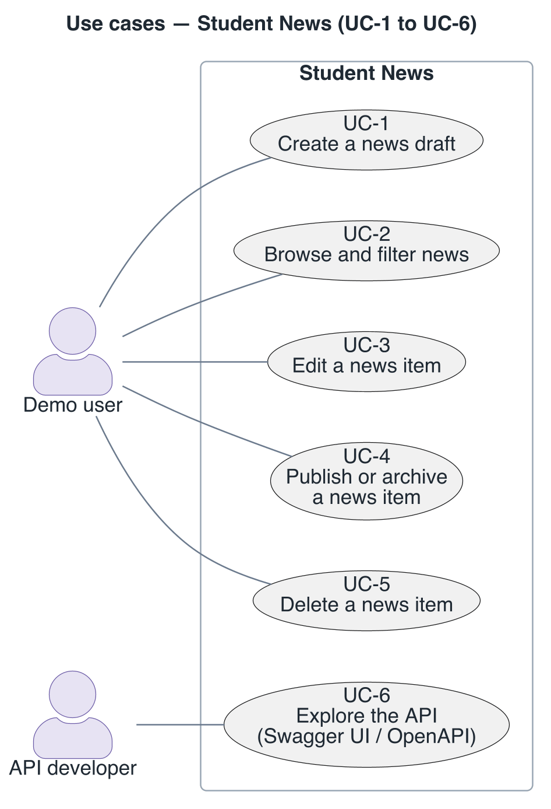
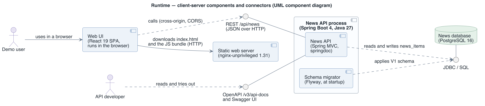
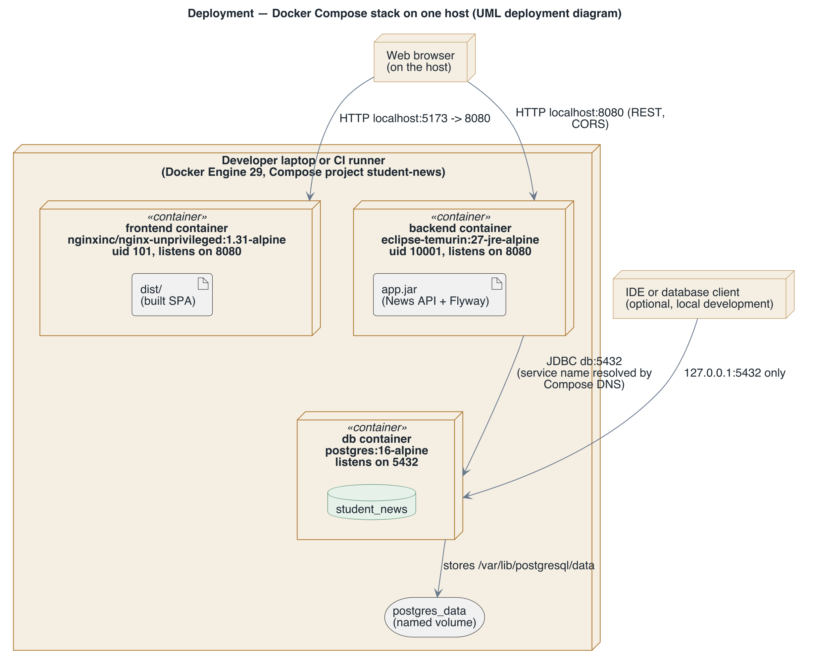

Checking for selectiveness

# Student News Demo

[](https://github.com/rtym/student-news/actions/workflows/ci.yml)
[](https://github.com/rtym/student-news/actions/workflows/e2e.yml)

Demo application for managing student news without authentication.

Supported operations:
- list news
- create news drafts
- edit existing news
- publish news
- archive news
- delete news
- add a picture to a post (needs [`avatar-service`](avatar-service/README.md), which Homework 12 containerises)

---

## Architecture

The architecture is described with the SEI **Views and Beyond** method in
[`architecture/docs/`](architecture/docs/README.md). Its [roadmap](architecture/docs/README.md)
says which document answers which question. Every diagram is UML, drawn with PlantUML; the
`.puml` sources sit next to the images in `architecture/docs/diagrams/`, and the colours are
explained in the [legend](architecture/docs/diagrams/legend.png).

| Document | What it answers | UML diagrams |
|----------|-----------------|--------------|
| [System overview](architecture/docs/system-overview.md) | What does the system do, and what shaped it? Use cases UC-1 to UC-6, constraints, quality scenarios | use case, component (context) |
| [Decomposition view](architecture/docs/view-module-decomposition.md) | Where does each piece of code live? | package |
| [Layered view](architecture/docs/view-module-layered.md) | Which backend class does what, and what may it call? | class |
| [Runtime view](architecture/docs/view-cnc-client-server.md) | What runs, how do the parts talk, and what is the REST interface? | component, sequence (UC-1, UC-2, UC-4), state machine |
| [Deployment view](architecture/docs/view-allocation-deployment.md) | Which container runs what, on which port, as which user? | deployment |
| [CI pipeline view](architecture/docs/view-allocation-ci.md) | Which job checks what before a merge? | activity |
| [Rationale](architecture/docs/rationale.md) | Why is it built this way? Six architecture decision records | — |

### Use cases

[](architecture/docs/system-overview.md#primary-functional-requirements-use-cases)

### Runtime components

[](architecture/docs/view-cnc-client-server.md)

### Deployment

[](architecture/docs/view-allocation-deployment.md)

---

## Tech stack

- PostgreSQL 16
- Java 27 + Spring Boot 4
- Spring Data JPA + Hibernate
- React 19 + Vite
- Docker + Docker Compose

---

## Project structure

```text
.
├── backend/              # Spring Boot API
├── frontend/             # React UI
├── e2e/                  # Playwright UI E2E tests
├── avatar-service/       # Homework 12 starter: post pictures, not yet containerised
├── docs/                 # BDD scenarios and teaching notes
├── architecture/         # Architecture description (Views and Beyond, UML)
├── .env.example          # Documented Compose settings (copy to .env)
└── docker-compose.yml    # Local deployment
```

---

## Prerequisites

- Docker Desktop installed and running
- Docker Compose v2 (`docker compose`)

---

## Quick start

From the project root:

```bash
docker compose up --build
```

No setup is needed: without a `.env` file Compose uses the defaults described in [Configuration (.env)](#configuration-env).

When containers are ready:

- Frontend: [http://localhost:5173](http://localhost:5173)
- Backend API: [http://localhost:8080/api/news](http://localhost:8080/api/news)
- Swagger UI: [http://localhost:8080/swagger-ui/index.html](http://localhost:8080/swagger-ui/index.html)
- OpenAPI JSON: [http://localhost:8080/v3/api-docs](http://localhost:8080/v3/api-docs)
- PostgreSQL: `localhost:5432`, published on `127.0.0.1` only, for a database client or a backend run outside Docker (the containers themselves do not need it)

Stop everything:

```bash
docker compose down
```

Stop and remove DB volume (clean reset):

```bash
docker compose down -v
```

---

## Containers

| Service | Base image | Runs as | Listens on (container) | Published on host |
|---------|------------|---------|------------------------|-------------------|
| `frontend` | `nginxinc/nginx-unprivileged:1.31-alpine` | `nginx` (uid 101) | 8080 | `5173` |
| `backend` | `eclipse-temurin:27-jre-alpine` | `app` (uid 10001) | 8080 | `8080` |
| `db` | `postgres:16-alpine` | `postgres` (server processes) | 5432 | `127.0.0.1:5432` |

Neither application container runs as root:

```bash
docker compose exec backend whoami    # app
docker compose exec frontend whoami   # nginx
```

The frontend's nginx listens on 8080 instead of 80, because binding a port below 1024 has traditionally required root. Compose maps it to 5173 on the host, so the URL does not change. The frontend and backend both listen on 8080 without clashing because each container has its own network namespace.

`docker compose exec db whoami` prints `root`: the Postgres image starts as root and its entrypoint switches to the `postgres` user before starting the server, but `exec` uses the image's default user.

---

## API

Base URL: `http://localhost:8080/api/news`

OpenAPI specification is auto-generated from code and available at:
- `GET /v3/api-docs` (JSON)
- Swagger UI: `/swagger-ui/index.html`

### Endpoints

- `GET /api/news` - list all news
- `GET /api/news?status=DRAFT|PUBLISHED|ARCHIVED` - list by status
- `POST /api/news` - create draft news
- `PUT /api/news/{id}` - edit news title/content
- `PATCH /api/news/{id}/publish` - mark as published
- `PATCH /api/news/{id}/archive` - mark as archived
- `DELETE /api/news/{id}` - delete news

### Create/update payload

```json
{
  "title": "Exam schedule announced",
  "content": "The exam period starts on June 3."
}
```

### Example requests

Create draft:

```bash
curl -X POST http://localhost:8080/api/news \
  -H "Content-Type: application/json" \
  -d '{"title":"Campus open day","content":"Open day starts at 10:00"}'
```

Publish news with id `1`:

```bash
curl -X PATCH http://localhost:8080/api/news/1/publish
```

Archive news with id `1`:

```bash
curl -X PATCH http://localhost:8080/api/news/1/archive
```

Delete news with id `1`:

```bash
curl -X DELETE http://localhost:8080/api/news/1
```

---

## Configuration (.env)

Docker Compose reads the database settings from environment variables, with defaults so the stack runs without any setup:

| Variable | Default | Used by |
|----------|---------|---------|
| `POSTGRES_DB` | `student_news` | `db` (creates the database), `backend` (JDBC URL) |
| `POSTGRES_USER` | `student` | `db`, `backend` |
| `POSTGRES_PASSWORD` | `student` | `db`, `backend` |

To change them, copy the documented example and edit the copy:

```bash
cp .env.example .env
```

`.env` is git-ignored; `.env.example` is committed and holds placeholders only. CI runs without a `.env` file, on the defaults.

Postgres applies these values only when its data volume is first created. After changing them, recreate the volume with `docker compose down -v`.

The backend reads:

- `SPRING_DATASOURCE_URL`
- `SPRING_DATASOURCE_USERNAME`
- `SPRING_DATASOURCE_PASSWORD`

Compose sets them from the variables above. The JDBC URL uses the service name as host name: `jdbc:postgresql://db:5432/student_news`. Started outside Docker, the backend falls back to `jdbc:postgresql://localhost:5432/student_news` with user and password `student` (see `application.properties`); if you changed the values in `.env`, set the three `SPRING_DATASOURCE_*` variables to match.

---

## Database migrations (Flyway)

Schema changes are managed with Flyway SQL migrations.

- migration folder: `backend/src/main/resources/db/migration`
- naming format: `V{number}__{description}.sql`
- example: `V2__add_news_summary_column.sql`

Current setup:
- Flyway runs automatically on backend startup
- Hibernate uses `validate` mode (it validates schema, but does not create/update tables)

To add a new migration:
1. Create a new SQL file in `db/migration` with next version number.
2. Put DDL/DML changes in this file.
3. Rebuild/restart backend (`docker compose up --build`).

If you already have a non-empty database without Flyway history, `baseline-on-migrate=true` is enabled for easier local onboarding.

---

## Testing (backend)

From `backend/`:

```bash
mvn test
```

- **Unit tests** (`NewsServiceTest`): Mockito-based; no database.
- **E2E REST tests** (`NewsApiE2ETest`): `@SpringBootTest` + `@AutoConfigureMockMvc` + **Testcontainers** PostgreSQL. They exercise the full stack (HTTP → controller → service → JPA → real DB, with Flyway migrations). **Docker must be running** so Testcontainers can start Postgres.

Shared Testcontainers configuration lives in `AbstractPostgreSQLIntegrationTest`.

### UI E2E tests (Playwright)

Browser tests drive the real React UI (clicks, typing) against a **Docker Compose** stack (Postgres + API + Nginx frontend), so the full path **UI → REST → DB** is exercised.

From the repository root:

```bash
cd e2e
npm ci
npx playwright install chromium
npm test
```

Default behaviour:

- **Global setup** runs `docker compose up -d --build` from the repo root, then waits until `http://localhost:8080/api/news` and `http://localhost:5173/` respond.
- **Global teardown** runs `docker compose down -v` (also mirrored in CI with `if: always()`).

If the stack is already running and you want to **skip** Compose management:

```bash
cd e2e
E2E_SKIP_DOCKER=1 npm test
```

Optional environment variables (defaults suit local Docker Compose port mapping):

| Variable | Purpose |
|----------|---------|
| `E2E_SKIP_DOCKER` | Set to `1` to skip `docker compose up` / `down` in Playwright global hooks |
| `PLAYWRIGHT_BASE_URL` | UI base URL (default `http://localhost:5173`) |
| `E2E_API_NEWS_URL` | REST base for test cleanup via `APIRequestContext` (default `http://localhost:8080/api/news`) |
| `E2E_API_HEALTH_URL` | URL polled in global setup (default `http://localhost:8080/api/news`) |
| `E2E_WEB_HEALTH_URL` | URL polled in global setup (default `http://localhost:5173/`) |

HTML report (after a run): `cd e2e && npx playwright show-report`

### CI (GitHub Actions)

Workflow [`.github/workflows/e2e.yml`](.github/workflows/e2e.yml) runs on pushes and pull requests to `main` / `master`: installs Playwright Chromium, runs `npm test` in `e2e/` (which starts Docker via global setup), uploads the Playwright HTML report on failure, and always runs `docker compose down -v`.

---

## Notes

- This project is intentionally simple and does **not** include authentication/authorization.
- It is designed for demo and local development purposes.

---

## Functional requirements (BDD)

BDD scenarios are documented in separate files:

- [API testing scenarios (BDD)](docs/api-testing-scenarios-bdd.md)
- [Frontend user scenarios (BDD)](docs/frontend-user-scenarios-bdd.md)
